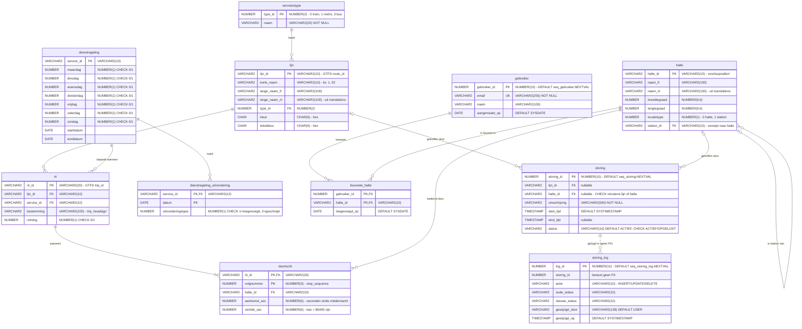

# Datamodel – MIVB reisinfo-databank

Fysiek datamodel zoals het in Oracle gebouwd wordt (sql/02_model_tabellen.sql). Het conceptuele ERD staat in erd_conceptueel.png.
Dit diagram rendert automatisch op GitHub (Mermaid). Lengtes van datatypes staan in de commentaar.

